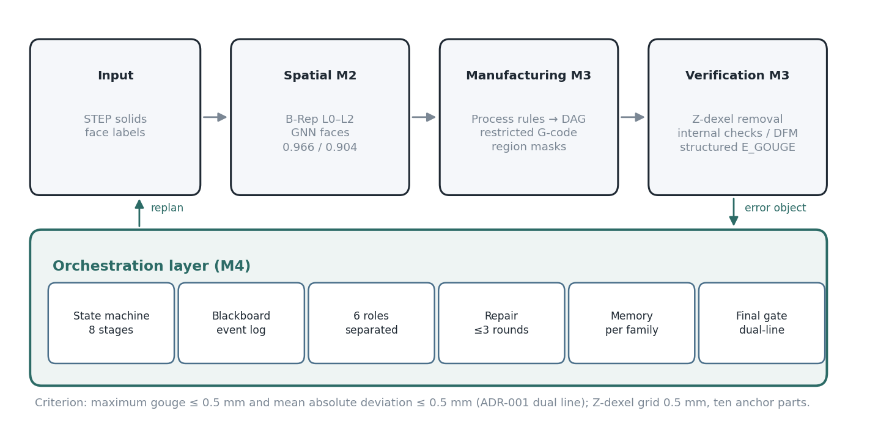
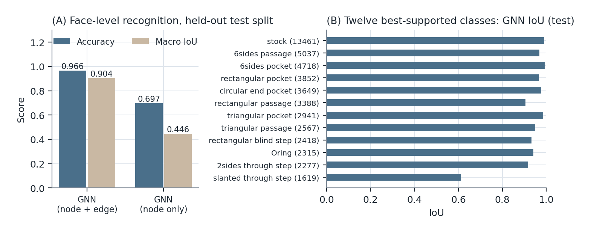
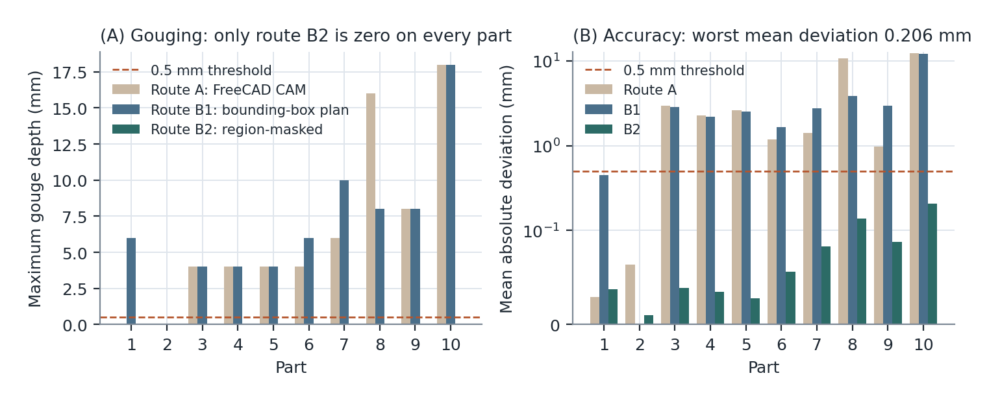
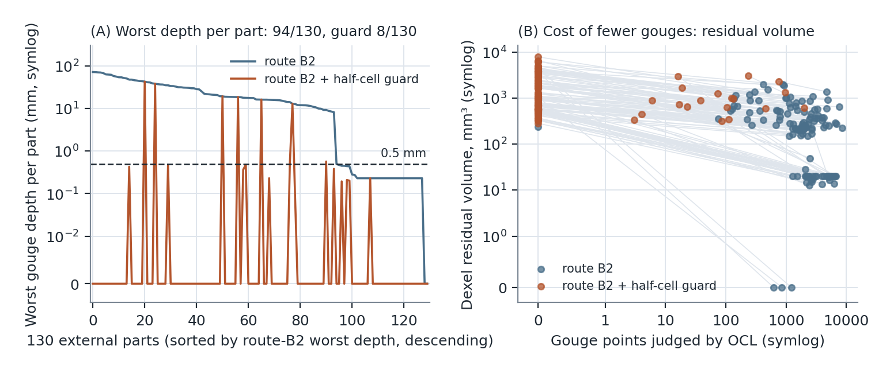
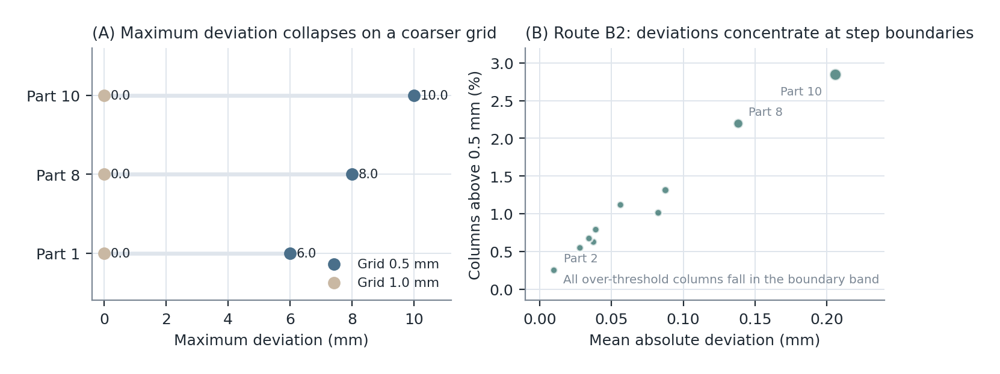
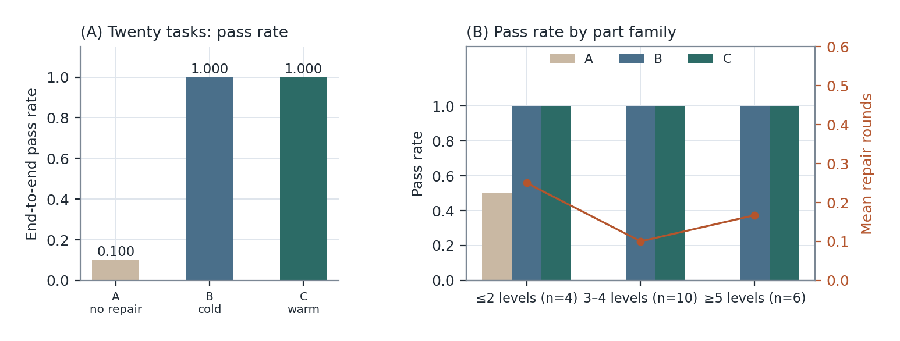

# 论文初稿（v0.2，历史中文工作稿）

> **本文件不再是当前稿。** 当前权威英文稿在 `latex/`（标题 *Auditing Foundation Model Grounding
> in Design and Manufacturing*，23 页），修订范围、数字纠错与未解问题见
> `docs/REVISION-HANDOFF-2026-11-13.md`。下文 §5 的部分解释（尤其 20/20、0/10、3.275%、
> 零过切）已被修订稿收紧，**不要据本文件改英文稿或恢复旧断言**。

> **中文工作标题**：几何约束下的可验证 CAD→CAM 智能体：区域掩码刀路、双线验收与有界修复
> **投稿标题（英文）**：Towards Spatial and Manufacturing Modalities: A Verification-Grounded
> Agent Architecture for Foundation Models in CAD/CAM
> **目标**：*Intelligent Computing*（IF 6.4 / JCR Q1，Science Partner Journal）特刊
> **"Foundation Models Beyond Text: Towards General Multimodal Intelligence"**（客座编辑已认可 Proposal 1）
> 类型：Research Article（≤15 000 words / ≤10 图表 / ≤60 参考文献 / Abstract ≤250 words）
> 全部数字取自 `reports/bench.json`（`make bench` 现算），不手抄。
> 作者/单位/致谢/基金：**待填**（见 §9 TODO）
> v0.2 变更（2026-11-09）：按特刊主题重排叙事主线；新增 §0 提案对齐说明与英文摘要；
> 重写 §1 引言、§2 相关工作；给「零过切」加离散口径限定，消除与 §7 的矛盾。**实验数据一字未动。**
> v0.2 修订（同日 10:30）：新增 §0.2 自主性层级
> （**权限上移而非降级**）与 §5.6 离线乐观上界；cover letter 与英文摘要口径同步。
> 新增证据为零 LLM 调用的离线分析，既有实验数据与默认值均未改动。

---

## 0 与特刊提案的对齐说明（可直接摘给客座编辑）

提案（Idea 1: *Multimodal Reasoning in Design and Manufacturing*）是探索性设想，成稿按实测结果
**收敛了未落地的实现选项，并把自主性主张精确到层级**（§0.2）。逐条列出，避免提案与成稿不符：

| 提案承诺 | 成稿实际 | 处置 |
|---|---|---|
| LLM e.g. **Qwen2.5** | 本地 Qwen3-8B / 14B + 10 个云端模型，共 **15 个模型**、三套任务集 | **升级**（§5.6）。提案模型已过时，换用更新版本并扩为跨规模/跨厂商对照 |
| **MCP gateway** | MCP stdio server + 工具契约层；13/13 事务回放、7 类错误 100% 拦截、失败零副作用 | **兑现**（§4.4、§1 报告） |
| **B-Rep feature extraction** | B-Rep 摘要 + 面级 GNN，MFCAD++ 96.60% / mIoU 90.42% | **兑现**（§4.2、§5.2） |
| **automated G-code generation** | **已兑现**：B-Rep → 工序 DAG → 区域掩码刀路 → 白名单 G-code 全程自动、无人工干预（`make bench` 一键产出 10 件 `.nc`）。变化的只是**执行主体**：由确定性生成器执行，模型输出意图工单（模型逐行写 G-code 为 0/10） | **主体澄清，不是能力删减**。系统自动化程度未降低；被关闭的只是「由模型逐行生成低级控制码」这一种动作空间（§0.2、§5.6） |
| **LLM-driven agent architecture** | LLM 承担意图解析、工具调用、策略选择、失败修复、歧义追问；几何计算、可行性判定、最终验收由确定性模块承担 | **改为 verification-grounded**：保留 agent 架构，把「谁驱动什么」写成实证结论而非先验设定 |
| **highly autonomous multi-agent systems** | 六角色 + 有界修复 + 情节记忆；模型在上表五个语义层端到端自主，几何生成与最终验收由确定性模块承担 | **自主性上移，不是降级**（§0.2）。实测放开「逐行写 G-code」是 0/10，把自主权限放在可判定动作空间上是 20/20。成稿写 *high autonomy within a verifiable action space*，不写 unconstrained autonomy |
| **high-end manufacturing** | 2.5D 多级腔、合成规则件、仿真验证、无真机 | **删除**，改为 controlled testbed / simulation-verified |
| spatial / geometric / manufacturing **modalities**, multimodal reasoning, **agentic interaction** | 空间（B-Rep 高度场）与制造（G-code / 材料去除）两类**可执行、有物理后果、可判定**的非文本模态；15 模型行为学实证；有界 agentic 闭环 | **保留并强化为全文主线** |

> 给客座编辑的说明（英文，可放 cover letter）：
> "The proposal described an exploratory scope with highly autonomous multi-agent systems.
> As the study matured, we used a single reproducible open-source kernel (FreeCAD 1.1.4)
> and **relocated**, rather than reduced, the agent's autonomy
> to the layers where outcomes are judgeable: intent parsing, contract-mediated tool use,
> strategy selection, bounded repair and clarification. Our measurements show why: direct G-code
> generation succeeds 0/10, and even projecting its tool centres onto the verifier's safe heights
> leaves 0/10, because the missing ingredient is toolpath coverage rather than cutting depth;
> the same model reaches 20/20 once the action space is a closed contract. We therefore report
> high autonomy within a verifiable action space, and present this reframing as a result of the
> study, not a retreat from the original ambition."

---

## 0.1 英文投稿标题与 Abstract（≤250 words）

**Title**: Towards Spatial and Manufacturing Modalities: A Verification-Grounded Agent
Architecture for Foundation Models in CAD/CAM

**Abstract**: Foundation models have moved beyond text mostly into perceptual modalities such
as images, video and audio. Engineering design and manufacturing pose a different class of
non-text modality: B-Rep geometry and material-removal processes are executable, physically
consequential and judgeable, where an error is scrapped material rather than a low score. We
present a verification-grounded agent architecture that connects foundation models to CAD/CAM
through a Model Context Protocol gateway, using FreeCAD 1.1.4 as a reproducible reference
kernel. B-Rep face-level recognition (96.60% accuracy, 90.42% mIoU on MFCAD++) feeds a
whitelist-constrained tool contract, a Z-dexel removal simulator and a region-masked toolpath
generator. Across 15 models (five local quantized, ten cloud), we find reliability is governed
by action space rather than model scale: under a closed contract, 20/20 Chinese work orders
execute correctly (feature-removal IoU 0.985), while direct G-code generation succeeds 0/10
and free-form modelling scripts reach IoU 0.17. A dual-line acceptance criterion separates
irreversible gouging from correctable residual material; on ten multi-level pocket parts,
gouging falls from 196,726.7 mm³ to zero **within the discrete Z-dexel representation**, and
bounded repair raises the end-to-end pass rate from 0.100 to 1.000 over 20 tasks. A third-party
OpenCAMLib audit detects sub-cell boundary violations at 3.275% of sampled tool centres over
130 external parts, delineating exactly where this zero-gouging claim holds. We argue that
this relocates rather than removes autonomy in physical modalities: models act end-to-end on
intent, tool use, strategy, repair and clarification, while low-level control codes remain
inside a judgeable action space.

**Keywords**: foundation models beyond text; spatial and manufacturing modalities; CAD/CAM;
Model Context Protocol; agentic interaction; executable verification

---

## 0.2 自主性层级：不是降级，是权限上移

提案主张 *highly autonomous multi-agent systems*。实测没有推翻它，而是**测出了自主性应当落在哪一层**。
把「模型被允许做什么」按动作空间分层，六层的实测结果如下（全部为本文已有实验，出处见对应章节）：

| 层 | 模型被允许做什么 | 实测 | 处置 |
|---|---|---|---|
| **L0** 低级控制码 | 逐行写 G-code | 双线 **0/10**；但 10/10 可解析、8/10 白名单合法，过切 3.956–48 mm、残留 9 056–43 864 mm³（§5.6） | **关闭** |
| **L0′** 建模脚本 | 写 FreeCAD Python 脚本 / 自由脚本 | 体积达标 **1/5**；自由脚本去除体积 IoU **0.174**（难工单 0.131） | **关闭** |
| **L1** 意图与工具调用 | 中文工单 → `cad.pocket/hole` 契约调用 | **20/20** 执行、调用合法率 1.000、去除体积 IoU **0.985**；8 条难工单 8/8；**15 个模型合法率全为 1.000** | **完全自主** |
| **L2** 工艺策略 | 选规划策略与修复动作 | 20/20 通过，但一句成本提示令 20/20 决策整体翻转（§5.6） | **自主 + 验证器兜底** |
| **L3** 失败自纠 | 读结构化错误、多轮修复、情节记忆 | 端到端 **0.100 → 1.000**，平均修复轮次 0.90 → 0.15；难工单 9/10 在 ≤2 轮内解决；云端强模型 1/4 → 4/4 | **自主 + 硬上界** |
| **L4** 需求澄清 | 欠约束工单主动追问 | 云端追问质量 **6.8/8**、本地 0.8/8（能力随模型移动） | **自主，需兜底** |

即：**L1–L4 模型是端到端自主的**（听懂 → 调用 → 决策 → 自纠 → 记忆 → 追问），
被关闭的只有 L0/L0′ 这两个**结果不可判定**的动作空间。本文主张的是**权限分配**
（autonomy relocation），不是能力降级：把自主性放到能被判定的层，用可执行验证为不可判定的层兜底。
这比 unconstrained autonomy 更强，因为它给出了边界的定量依据，也正对应特刊的 *agentic interaction*。

**为什么不给 L0 加一个「验证器反馈 + 重写」就放开？** §5.6 的离线乐观上界回答了：
把 10 件模型原始 G-code 的刀心 z 投影到验证器给出的最低安全高度（只抬高、不新增刀路、
模型看不到目标高度图），双线仍是 **0/10**；平均最深过切 10.596 → 4.996 mm、2 件降到 0，
但平均残留 **25 503 → 25 623 mm³**、均偏差仍全部超线。失效的是**刀路覆盖规划**，不是下刀深度：
验证器能指出「切深了」，却补不出模型根本没走过的刀路。
所以 L0 的出路不是重写，而是换到可判定的动作空间——这与 Plan then Act（ICLR 2026）在 CAD 侧
引入中间层的结论同向，本文在制造侧给出了「物理后果可判定」这一更强的理由。

---

## 摘要

基础模型"超越文本"的进展主要落在图像、视频、音频等**感知型**模态上。工程设计与制造面对的是
另一类非文本模态：B-Rep 几何与材料去除过程是**可执行的、有物理后果的、可判定的**——出错不是
分数低，而是工件报废。本文提出一个**以可执行验证为接口**的 agent 架构，通过 Model Context
Protocol 网关把基础模型接入 CAD/CAM，以 FreeCAD 1.1.4 为可复现的开源参考内核。架构把
B-Rep 面级加工特征识别（MFCAD++ 96.60% / mIoU 90.42%）、白名单约束的工具契约、
Z-dexel 材料去除仿真与**区域掩码刀路**串成一条从空间模态到制造模态的链路。
在 **15 个模型**（5 个本地量化 + 10 个云端）上，我们给出本文的核心实证结论：
**可靠性由动作空间决定，而非模型规模**——封闭契约下 20 条中文工单执行 20/20、
特征去除体积 IoU **0.985**；放开生成后，同一模型直接写 G-code **0/10**、
写建模脚本的特征 IoU 仅 **0.17**。跨模型对照进一步显示能力边界随规模与厂商移动：
一句成本提示可让 20/20 的安全/工时决策整体翻转；结构化反馈在 8B 上无效、
14B 上 4/4、云端强模型 1/4→4/4；欠约束工单的澄清质量云端 6.8/8、本地 0.8/8。
为使这类模态可被判定，我们提出**双线验收**（最大过切 ≤0.5 mm 且平均绝对偏差 ≤0.5 mm）：
常用"最大偏差"口径在此类零件上会给出反向结论（最坏 10 mm 全是残留，栅格 0.5→1.0 mm
时该指标从 10 mm 跳到 0 mm，纯离散化伪影）。在 10 件多级腔零件上，区域掩码把总过切从
196 726.7 mm³ 降到 **0 mm³**、最坏平均偏差 12.118 → **0.206 mm**（均在 Z-dexel 单值高度图
与生成/验证共用的离散圆盘口径内）；状态机 + 黑板 + 六角色 + 有界修复 + 情节记忆使
20 任务的端到端通过率 **0.100 → 1.000**、平均修复轮次 **0.90 → 0.15**。
最后，我们用 CAMotics 与 OpenCAMLib 两个独立内核做交叉验证，并**主动报告口径边界**：
第三方连续几何内核在 130 件外部集的抽样刀心点上检出 **3.275%** 的亚格边界过切
（锚点集 0.76%），其中 24.5% 深于 0.5 mm；半格余量可消除 98.4%，但残留涨 4.42 倍、
双线掉到 107/130。这说明「零过切」有明确定义域，也说明**可执行验证既是基础模型接入物理
模态所需的接口，其自身离散化也必须被第三方审计**。

**关键词**：超越文本的基础模型；空间与制造模态；CAD/CAM；Model Context Protocol；
智能体交互；可执行验证；动作空间

---

## 1 引言

基础模型从文本走向多模态，主流进展集中在**感知型**模态：图像、视频、音频。但"通用多模态
智能"还缺一类模态——工程设计与制造中的 B-Rep 几何与材料去除过程。它们不是被"看懂"的对象，
而是**可执行、有物理后果、且可判定**的状态空间：一条 G-code 指令会真的移除材料，过切不可逆、
直接报废。这里有三道硬约束：几何上不能过切、工艺参数不能越界（转速/进给/切深有材料-刀具
包络）、程序必须是控制器能解释的子集。任何一条不满足，输出就不是"次优"，而是"不可用"。

近两年基础模型已开始进入这一空间：CAD-Coder（NeurIPS 2025）用几何奖励的强化学习让模型
生成 CadQuery 脚本；Graph-CAD 与 Plan then Act（均为 ICLR 2026）用显式层级/双层规划降低
直接生成 CAD 命令的无效率。这些工作回答的是「**怎样让模型把几何生成对**」，评价指标是
重构误差、有效性与几何保真度。本文问的是一个互补的问题：**当输出会真的切掉材料时，
模型应该被允许做什么、系统又该怎样判定结果**。Plan then Act 的前置实验已显示 GPT-4o
直出低层 CAD 命令无效率 70.35%（PTA 降到 0.85%）；我们在制造侧给出同向但更严的证据，
并把它从「生成质量」推进到「物理后果可判定性」。

本文的出发点是：**基础模型接入物理模态，需要一层可执行的判定接口**。具体贡献：

1. **空间与制造模态的形式化**（§3、§4.2–4.4）：把 B-Rep 面邻接/高度场与 G-code/材料去除
   定义为两类可执行非文本模态，通过 MCP 网关 + 白名单工具契约接入模型；B-Rep 面级识别
   MFCAD++ 96.60% / mIoU 90.42%。网关后端可替换，本阶段以 FreeCAD 1.1.4 为参考实现。
2. **动作空间决定可靠性（核心实证，§5.6）**：跨 **15 个模型**（5 本地量化 + 10 云端）、
   三套任务集，只换动作空间——封闭契约下中文工单 20/20、特征去除体积 IoU **0.985**；
   自由生成 G-code **0/10**、建模脚本 IoU **0.17**。能力边界随规模与厂商移动：
   一句成本提示让 20/20 决策翻转；结构化反馈 8B 无效、14B 4/4、云端 1/4→4/4；
   澄清质量云端 6.8/8、本地 0.8/8。**单模型结论不可外推**。
3. **双线验收口径**（§4.6、§5.4）：把不可逆过切与可补刀残留分开；证明常用"最大偏差"
   在多级腔 + 离散栅格下会给出反向结论（10 mm 全是残留，栅格粗化后跳到 0 mm）。
4. **区域掩码刀路**（§4.5、§5.3）：对每个目标高度层 $L$，刀心可行域取"高于 $L$ 的材料
   按刀半径膨胀后的补集" $\mathcal{F}(L)$；10 件多级腔零件总过切 196 726.7 → **0 mm³**、
   最坏平均偏差 12.118 → **0.206 mm**（均在 §7-7 限定的离散口径内）。
5. **有界 agentic 闭环**（§4.7、§5.5）：`E_GOUGE` 携带 `op_id / face_ids / by_op`，
   修复器据此换规划器而非盲调参数；状态机 + 黑板 + 六角色 + 情节记忆使 20 任务通过率
   **0.100 → 1.000**、平均修复轮次 **0.90 → 0.15**，失败必须上报。
6. **接口自身的第三方审计**（§5.3b）：CAMotics（体积）与 OpenCAMLib（逐点几何）交叉验证，
   并主动披露离散化边界——130 件外部集上 3.275% 刀心点存在亚格边界过切、24.5% 深于
   0.5 mm；半格余量消掉 98.4% 但残留涨 4.42 倍。**验证器不是免检的**，这是本文对
   "可执行验证"这一主张自身的约束。

**边界与分工（实证结论，不是先验设定）**：LLM 承担意图解析、工具调用与澄清；几何计算、
可行性判定与最终验收由确定性模块承担。这一分工来自第 2 条的对照实验，而非架构偏好。
本文不处理五轴/倒扣/薄壁变形，不主张端到端替代 CAM 工程师，所有结论均为仿真验证、
未做真机切削（§7）。

---

## 2 相关工作

### 2.1 几何深度学习与 B-Rep 特征识别

MFCAD++、ABC、Fusion360 Gallery 提供面级/实例级标注，面邻接图上的消息传递是主流做法。
本文沿用该范式但把它当作**上游**：识别结果只用于生成工序，最终判据是材料去除后的物理结果，
而非分类准确率。

### 2.2 基础模型驱动的 CAD 生成（最相近，须逐篇区分）

DeepCAD 把 CAD 表示为命令序列，Text2CAD 建立文本—序列配对；2025–2026 年这一方向迅速进入
主流会议：

| 工作 | 做法 | 评价指标 | 与本文的关系 |
|---|---|---|---|
| **CAD-Coder** (Guan et al., NeurIPS 38, 2025, 59765–59789; arXiv:2505.19713) | 文本→CadQuery 脚本；110K 三元组 SFT + GRPO（Chamfer 几何奖励 + 格式奖励）+ CoT | 几何保真度、代码有效率 | 让模型**生成可执行几何代码**。本文不让模型生成几何，而是限制其只能下工单 |
| **Graph-CAD** (ICLR 2026, OpenReview oKMomThD6n) | 显式装配层级 + 几何约束分解图作中间表示，渐进式课程学习 | CADBench 几何约束满足率 0.40→0.90 | 用**结构化中间表示**提升生成。本文的结构化中间层是工具契约 + 可判定判据，目标不是生成质量 |
| **Plan then Act / PTA** (Guo et al., ICLR 2026, poster 10010015) | 微调 Planner (Qwen3-8B) 出高层计划，Actioner + 需求感知机制出低层命令 | 无效率 IR：GPT-4o 直出 70.35%、微调 Qwen3-8B 20.06%、PTA **0.85%**；Chamfer / F1 | **结论与本文 B7 同构**：LLM 不宜直出低层控制码。差别见下 |

PTA 的前置实验是本文最需要正面区分的一项：它同样发现「直接生成低层控制码不可靠」，
但其解法是**训练一个更好的生成器**（双层规划 + 微调 + RAM），优化目标仍是命令序列的
有效性与几何相似度。本文不训练生成器，而是**把动作空间本身作为自变量**：同一批零件、
同一批模型，只切换「封闭契约 / 自由生成」，得到 20/20 与 0/10 的分野；并把判据从
「命令是否有效、几何是否相似」换成「材料是否被错误移除、错了能否定位到工序并修复」。
因此在本文里，PTA 的前置实验是**前提**而非竞争结论：我们进一步给出跨 15 模型的
动作空间对照、物理后果判据，以及修复闭环的收益与边界。

### 2.3 LLM 与 G-code / 加工验证

Šket et al.（*Adv. Prod. Eng. Manage.* 20(2), 2025, 224–238）比较 GPT-3.5 / GPT-4o 生成
三轴 ISO G-code 的能力，并在 CAM 软件中人工检视；Eniş et al.（*J. Adv. Manuf. Eng.*
7(1), 2026, 31–43）用数字孪生验证 LLM 在面铣中的刀具与参数建议；
Pour et al.（arXiv:2512.11296, 2025）用少样本 VLM 结合 G-code 文本与 HMI 截图查错。
这些工作评估或辅助模型的**生成/判断能力**，验证依赖人工、CAM 软件或视觉比对。
本文的验证是确定性的材料去除仿真：过切/残留被量化为带工序归因的结构化字段，
并由两个独立第三方内核复核（§5.3b）。

### 2.4 CAM 自动化与可加工性仿真

商用 CAM 依赖特征识别 + 工艺库 + 后置处理；开源侧 FreeCAD Path 提供面铣/型腔/钻孔算子，
本文用其作**对照**（A 路，2/10 达标）并报告失败模式。Z-dexel / dexel 类材料去除仿真、
OpenCAMLib（刀位曲面）与 CAMotics（G-code 体积仿真）在本文中承担**判据与交叉验证**，
不作为被比较的生成器。

### 2.5 智能体、工具使用与可验证接口

ReAct、Reflexion 强调失败后反思重试，Model Context Protocol 统一工具暴露方式。本文沿用
MCP 作为网关协议，但重试输入不是自然语言反思，而是**结构化错误 + 工序归因**；重试有硬上界，
失败必须上报；且每一轮结果都由外部可执行判据复核，而非由模型自评。

### 2.6 三点区别（回应 "incremental" 质疑）

1. **模态性质不同**：上述多模态/生成工作面向感知型或静态几何对象；本文面向**可执行、
   有物理后果、可判定**的空间与制造模态，错误不可逆。
2. **研究问题不同**：不是「怎样让基础模型学会几何」，而是「模型应被允许做什么，以及
   系统如何判定结果」；动作空间是自变量，模型规模是控制变量（15 个模型）。
3. **判据不同**：不用重构误差、无效率或任务成功率，而用材料去除后的**双线验收**
   （不可逆过切 / 可补残留），并由独立 CAM 内核审计判据自身（§5.3b）。

---

## 3 任务定义

给定零件实体 $P$（三角网格 + 面级特征标签）与材料牌号 $m$，输出受限 G-code 程序 $G$，
使得材料去除后的剩余体 $S(G)$ 满足：

$$
\text{gouge}_{\max}(S,P)\le 0.5\,\text{mm}
\quad\text{且}\quad
\overline{|S-P|}\le 0.5\,\text{mm}
\tag{1}
$$

其中第一项是**安全线**（过深不可逆），第二项是**精度线**（残留可补刀）。
两线缺一不可：只报精度会把"切穿"平均掉，只报安全会放过"整面没切到"。

---

## 4 方法

### 4.1 总览

见图 1。上排是四段式流水线（输入 → 空间模态 → 制造模态 → 验证），
下排是编排层（状态机 / 黑板 / 六角色 / 有界修复 / 记忆）。



<div align="center"><sub>图 1　框架总览：上排为四段式流水线，下排为编排层（状态机 / 黑板 / 六角色 / 有界修复 / 记忆）。</sub></div>

### 4.2 空间模态：B-Rep 摘要与面级识别

三级摘要 L0–L2：L0 为全局不变量（面/边/凹边计数、包围盒、体积、面积），
L1 为类型直方图，L2 为逐面表（曲面类型、面积、法向、邻接）。
识别器为 3 层消息传递网络（0.35 M 参数），面特征 + 边特征 + 类型嵌入，
输出 25 类加工特征的逐面标签。

### 4.3 制造模态：工艺库与工序 DAG

工艺库把材料 × 刀具 × 参数包络编码为钳制函数：给定期望值，返回**夹到包络内**的值
与违规记录（不静默修改）。工序规划按"面铣 → 型腔 → 钻孔 → 轮廓"生成线性 DAG，
毛坯在成品顶面留 1 mm 余量（否则面铣无料可切，仿真退化为空操作）。

### 4.4 受限 G-code 与解析闭环

生成器只输出白名单内的 G/M 代码（G0/G1/G2/G3/G17–G19/G40–G59/G73–G83/G90–G94 等）。
解析器把文本还原为刀路 IR（含工序标签），并做三项静态检查：未知代码、主轴未开切削、
G0 在毛坯内横穿（干涉）。文本与 IR 双向可核对——这是"可验证"的第一层。

### 4.5 区域掩码刀路（核心）

设目标高度图 $h(x,y)$（由三角网格栅格化，栅格 $r=0.5$ mm），刀具半径 $\rho$。
对任一目标高度层 $L$，定义材料集与刀心可行域：

$$
M(L)=\{(x,y)\mid h(x,y)>L\},\qquad
\mathcal{F}(L)=\mathbb{R}^2\setminus\bigl(M(L)\oplus D_\rho\bigr)
\tag{2}
$$

即：**刀心只能落在"离所有高于本层的材料都超过 $\rho$"的位置**。
在 $\mathcal{F}(L)$ 内以步距 $s$ 生成平行走刀，逐层下刀（切深 $a_p$），
则任一柱 $(x,y)$ 的最终高度 $\ge L$ 当且仅当该层被覆盖，故 $\text{gouge}\equiv 0$。
实现上按层做形态学膨胀 + 连通区扫描，输出带工序标签（`HM<pass>_L<level>`）的 G-code，
使仿真可逐层归因。

### 4.6 双线验收与它的反直觉之处

式 (1) 的第二项用**平均绝对偏差**而非最大偏差，理由在 §5.4 给出：
多级腔零件的最大偏差几乎总出现在台阶边界的窄柱上，属"刀径够不到"的残留，
物理上可补刀；而栅格粗化会让这些柱消失，最大偏差随之"归零"。
把两者混在一个 $|S-P|$ 里，指标就同时在测"切坏"和"没切到"，且对分辨率敏感。

### 4.7 编排层：状态机、黑板、有界修复、记忆

- **状态机**：`INIT→ANALYZE→PLAN→EMIT→VERIFY→{ACCEPT | REPAIR→EMIT→VERIFY | ESCALATE}`，
  非法跳转直接抛错（不是靠约定）。
- **黑板**：唯一共享介质，任务输入直接上板；每次写入与决策进事件日志（带角色与序号），
  内容指纹用于"同输入重跑是否一致"的自检。
- **六角色**：分析 / 规划 / 后置 / 验证 / 修复 / 终审，只读上游键、只写自己的键，互不调用。
  M4 阶段它们是确定性策略——先把"壳子"证明对，再换模型（§7）。
- **有界修复**：两档台阶（包围盒 → 区域掩码），第 2 档仍不合格则 `ESCALATE`，
  携带 `blocking` 与错误对象；上界 3 轮是护栏。
- **记忆**：按**零件族**检索（族由目标高度层数派生，可预计算），按失败签名留档
  （`族|错误码`，不含零件号）；只复用成功过的修法。

---

## 5 实验

### 5.1 设置

| 项 | 内容 |
|---|---|
| 数据 | RPTU Zenodo 17035762，10 件多级腔零件（STEP + 参考 .ngc + 渲染图），CC-BY 4.0；面级标签由本文标注：**206 面 / 62 个特征实例**，两名标注员在 30 个分层抽样面上的 κ = **0.751**（95% CI 0.570–0.912），毛坯/加工二值一致率 1.000 |
| 识别训练 | MFCAD++（7998/1500/1998 件），0.35 M 参数，40 epoch |
| 仿真 | Z-dexel，栅格 0.5 mm，刀径按工序取（Ø1.5–Ø10） |
| 口径 | 式 (1)，阈值 0.5 mm，与生成方法无关 |
| LLM | Qwen3-8B（Q4_K_M，8.2B）本地 Ollama，单卡 RTX 4090，`temperature=0`，`think=false` |
| 复现 | `make bench`（约 2 分钟）→ `reports/bench.json`；6 张主图 `make figures`；LLM 实验 `make llm-eval` |

**标注质量的一个附带发现**：先用规则做预标注，再人工逐面复核，规则只对了 **54.4%**
的面（`data/zenodo_rptu/labels/*.draft.json` vs 最终标注）。也就是说"看起来有规律"的
几何，靠规则仍会错掉近一半——这也是我们把识别交给学习模型、而不写更多规则的理由。

### 5.2 面级特征识别



<div align="center"><sub>图 2　(a) 整体指标；(b) 支持面数前 12 类的逐类 IoU（括号内为测试面数）。</sub></div>


| 方法 | 准确率 | mIoU | 参数量 |
|---|---|---|---|
| GNN（节点+边） | **0.9660** | **0.9042** | 0.35 M |
| 决策树基线 | 0.9075 | 0.7198 | — |
| GNN 仅节点（消融，验证集） | 0.7042 | 0.4529 | 0.35 M |

消融说明：**边特征（凸凹、邻接角）贡献了 26 个百分点的准确率**，
去掉后连决策树都不如。这条对下游很重要——工序规划依赖"凸台 vs 型腔"的判定，
而这个判定几乎全靠边。

> 口径提示：决策树基线的数字来自其验证集（其训练脚本未做 test 评测），
> 表中已注明，不与 GNN 的 test 数字直接比较。

### 5.3 三路刀路对比



<div align="center"><sub>图 3　10 件锚点集上三路刀路的 (a) 最大过切深度与 (b) 平均绝对偏差；虚线为 0.5 mm 阈值。B2 的过切恒为 0。</sub></div>


| 路线 | 总过切 (mm³) | 最坏最大偏差 (mm) | 最坏平均偏差 (mm) | 双线通过 |
|---|---|---|---|---|
| A：FreeCAD Path（面铣/型腔/钻孔） | 215 126.7 | 19.0 | 12.225 | 2/10 |
| B1：包围盒计划（本文 M3.1） | 196 726.7 | 19.0 | 12.118 | 2/10 |
| **B2：区域掩码（本文）** | **0.0** | 10.0（全为残留） | **0.206** | **10/10** |

A 路是**负结果**：用工业通用算子（`MillFace` + `BoundaryShape=Face Region`）逐面加工，
在多级腔上仍会过切——根因是 `MillFace` 的语义是"铣平到某个 z"，遇到同一 z 上的多个
不连通区域时会退化为包围盒。我们试过四种 `BoundaryShape` 组合，均无法约束（附录 B）。
这不是配置问题，是算子语义与"按高度层加工"不匹配。

### 5.3b 外部验证与第三方交叉验证

主实验只有 10 件锚点件，两个必然被问的问题是"是不是只对这 10 件有效"和
"验证器是自写的，凭什么信"。

**外部验证集（130 件）**。从 MFCAD（MIT 许可，15 488 个 STEP）按文件名里的特征序列
筛出 1 947 个可映射件，再跑几何筛出 **130 件**（原始尺度下 3–10 个高度层、8–60 个面），
按长边统一缩放到 80 mm 以沿用 Ø6 刀具与 0.5 mm 阈值。用与锚点集**完全相同**的双线判据：

| | 数量 | 双线通过 | 最坏过切 | 最坏平均偏差 |
|---|---|---|---|---|
| MFCAD 外部件 | 130 | **130 / 130** | **0.000 mm** | **0.306 mm** |

按层数分组的每一档（3–10 层，各 10–18 件）都是满通过。
需要说明：MFCAD 是 PythonOCC 合成的规则件、无凸台、特征以单层为主，
它证明"方法不依赖那 10 件"，不证明"能处理任意工业件"。

**零过切来自哪一步**。把区域掩码里的"按刀半径膨胀"单独关掉（`inflate=False`），
其余完全相同：

| | 双线通过 | 最坏过切 | 平均偏差 |
|---|---|---|---|
| B2（膨胀） | **10 / 10** | **0.000 mm** | 0.072 mm |
| B3（不膨胀） | **0 / 10** | **18.000 mm** | 0.914 mm |

B3 的过切恰好等于"刀半径 + 该处层高"——刀心贴到台阶边缘，刀径多切一圈。
**零过切不是"知道哪里要保留"带来的，而是"按刀半径把保留区膨胀"带来的。**

**第三方交叉验证**。CAMotics 1.2.0 是独立的开源 G-code 仿真器（表面网格切削，
算法与 Z-dexel 完全不同）。同一份 G-code、同一毛坯、同一组刀具，比被切后工件的体积：

| 件 | 1 | 2 | 3 | 4 | 5 | 6 | 7 | 8 | 9 | 10 |
|---|---|---|---|---|---|---|---|---|---|---|
| 相对差 | 0.10% | 0.37% | 0.72% | 0.42% | 0.28% | 0.93% | 1.93% | 1.04% | 2.50% | 3.22% |

均值 **1.15%**、最大 3.22%、P95 2.90%，误差随层数增加（层数越多，台阶边界越长）。
这条证据的意义不在"误差小"，而在**两个独立实现给出同一结论**：我们的 dexel 没有系统性偏差。

**第二个第三方内核：逐点几何，而不是体积。** CAMotics 只回答"切掉多少材料"，
回答不了"每个刀心位置在连续几何上会不会碰材料"，也绕不开"生成器和验证器共用同一套
离散圆盘"的循环论证。为此我们引入 OpenCAMLib 2023.1.11（LGPL-2.1，C++ CAM 内核，
`pip install`，无 GUI、版本可钉死）作为**独立 CAM 内核**：其 drop-cutter 用连续三角形–
刀具求交给出刀心在 `(x,y)` 的最低安全 Z，与我们的栅格圆盘卷积在算法上完全不同。
原计划的 Fusion 360 GUI 导出 `.nc` 因此取消——它要账号、参数不可控、不可复现。

| 独立内核 | 比对对象 | 结果 |
|---|---|---|
| 目标几何 | Ø0.02 点刀高度图 vs `rasterize` | 256 000 柱一致 ≥ **99.828%**，覆盖 IoU **1.0000**；120 柱（0.047%）差在圆弧台阶边界 |
| 过切判据 | B2 / B3 / 第三方刀路逐刀心点 | B2 **2 822/371 230**（0.76%）、B3 **43 260/408 646**（10.59%，最深 18.0 mm）、OCL 自生成刀路 **0** |
| 验证器特异性 | OCL 自生成 constant-Z 刀路 → 我们的双线判据 | **9/10 通过**；件 10 安全线 0 过切、精度线 0.538 mm 未过（真实残留） |

坏刀路（B3）被拒、好刀路（OCL）被收，说明验证器不是只对自家的生成器放行。
CAMotics（体积）与 OpenCAMLib（逐点几何）构成两条互不依赖的第三方证据链。

**输入几何也换一条链路复核。** 上表第一行的 OCL 曲面由我们的 `geom` JSON 缓存
逐三角构造，仍可能与验证器共享解析偏差。为此再用 `freecadcmd` 把 10 个 STEP 经
`Part.Shape.tessellate(0.05) → Mesh.Mesh → 二进制 STL` 导出，由 `ocl.STLReader`
读入（完全绕开 JSON 缓存）：两条链路喂出的 OCL 高度图逐柱一致 **≥ 99.984%**，
4 件纯平面件为 **0.0000 mm** 差；仅 6 件带圆弧面的零件在台阶边界共 **15 柱**
（≤ 0.06%）差一个层深，原因是两个三角化器对圆弧的切法不同。STL 链路给出的
B2/B3 过切点 **2 826 / 43 262**，与 JSON 链路的 2 822 / 43 260 相差 **< 0.15%**，
结论不变。需要明确：**读 STEP 的 B-rep 内核仍是 OCC，这不是第二个 CAD 内核**；
独立的是三角化、文件序列化与几何读取链路，它检验的是输入网格有无系统性偏差。

**这个交叉验证查出了一个我们自己的盲点，必须主动披露。** 离散膨胀按"柱心→柱心"量距离，
连续几何按"柱心→台阶边"量，在圆弧边界最多少盖半格；我们的 dexel 用同一套圆盘，
因此两者互相看不见。三条证据表明这是**分辨率伪影而非几何错误**：
① 件 10 同一条 B2 规则只改栅格，OCL 过切率 **1.332% → 0.432% → 0.143%**
（`res` 0.5/0.25/0.125 mm）单调收敛；② 给膨胀半径加 `guard_mm = res/2`，
过切点 **2 822 → 41**（件 10 1 075 → 0）；③ 但代价真实：残留 **4 606 → 15 886 mm³**
（3.4×）、双线 **10/10 → 9/10**（件 10 均偏差 0.702 mm）。
在 0.5 mm 栅格上，"连续几何零过切"与"双线精度线"不能同时满足；
两者兼得需要连续几何偏置或更细栅格，属后续工作。完整数据与候选工具对比见
`docs/M6-OPENCAMLIB.md`。

**把第三方判据扩到 130 件外部集（图 6）。** 10 件锚点集是密集 STEP 剖分、
轴对齐矩形台阶，只暴露了圆弧边界的半格效应。MFCAD 130 件是**稀疏大三角**
（一个顶面三角可跨 60 mm）与斜边台阶，栅格覆盖率均值 96.849%、最低 77.465%，
构成压力测试。同一口径（`res=0.5 mm`、Ø0.02 点刀、0.02 mm 相切间隙）下：

| | 10 件锚点集 | 130 件外部集 |
|---|---|---|
| OCL 判 B2 过切率 | 0.76%（2 822/371 230） | **3.275%**（316 398/9 660 095） |
| OCL 判 B3 过切率 | 10.59%（43 260/408 646） | **14.468%**（1 571 946/10 865 228） |
| 我们的双线判据 | B2 10/10、B3 0/10 | **B2 130/130、B3 0/130** |
| `guard=0.25 mm` 后 | 过切 2 822→41、双线 10→9/10 | 过切 316 398→**5 167**、双线 130→**107/130**、残留 **4.42×** |

方向性结论不变（B3 被大比例拒绝、B2 显著更低），但**规模把盲点放大了**：
B2 的 316 398 个过切点里 24.5% 深于 0.5 mm、最深 71.104 mm（锚点集最深 18 mm）。
分成两类：43.5% 落在**三角网格未覆盖的栅格柱**——`rasterize` 记为空气，
生成器与验证器都跳过，OCL 的连续刀盘却碰到相邻高台，属**验证器假阴性**；
56.5% 落在覆盖完整（100%）的件上，是**斜边台阶边界的柱心膨胀失效**。
两类都指向同一件事：生成器和验证器共用同一套离散圆盘。



<div align="center"><sub>图 6　(a) 每千刀心点的过切点数，按件降序：浅过切（≤0.5 mm，半格边界）
与深过切（>0.5 mm，离散掩码/连续几何口径差），叠加半格余量后的曲线；
(b) 每件从 B2 到加余量的帕累托位移（双对数）：过切点数下降、残留体积上升。</sub></div>

另外必须解释两个口径数字：外部集的**几何最大差 71.104 mm** 是 Ø0.02 点刀
擦到竖直壁三角造成的探针伪影，把点刀缩到 Ø0.002 后 130 件超差柱
**199 → 2**、最大差降到 21.4 mm，缩到 Ø0.0002 后仅余 1 柱（柱心恰落在三角形边界
的数值歧义）；**一致率最差 87.364%** 只是 0.02 mm 阈值与点刀数值误差同量级造成的假象，
该件最大差仅 0.023 mm。点刀敏感性台账见 `reports/m6_ocl_point_cutter.json`。

> **口径收紧**：本文所有"零过切"均指 **Z-dexel 单值高度图 + 同一套离散圆盘** 口径内；
> 不得写成"连续几何上零过切"或"对任意几何保证零过切"。外部集的主要统计价值是
> 把双线通过率的 Wilson 95% 下界从 0.7225 抬到 **0.9713**（§5.4），
> 同时给出方法失效的边界。方法与逐件数据见 `docs/M6-OCL-EXTERNAL.md`。

### 5.4 验收口径：为什么不能用最大偏差



<div align="center"><sub>图 4　(a) 同一刀路在两种栅格下的最大偏差异常敏感；(b) B2 的超差柱占比与平均偏差，点面积表示残留体积。</sub></div>


1. **最坏 10 mm 全是残留**：B2 在 10 件上的 `max_gouge_depth = 0.000`，
   所有超差柱都在"材料比目标高"的一侧，即可补刀。
2. **最大偏差随栅格跳变**：同一刀路，栅格 0.5 → 1.0 mm 时，件 1/8/10 的最大偏差
   由 6/8/10 mm 变为 **0/0/0**——那些窄柱被栅格吞掉了。用它当验收线，等于在测分辨率。
3. **超差柱高度聚集**：最坏件（10 号）超 0.5 mm 的柱占 2.844%，其中 **100%** 落在
   台阶边界带（±1 格）内，且最大连通簇占 100%——是"刀径够不到"，不是"路径乱走"。
4. **补细刀能归零但代价不现实**：加 Ø0.75 精刀可把平均偏差压到 0，但 G-code 从
   10 439 行涨到 28 245 行（2.7×）。我们把它作为"分辨率上界"实验报告，不作为方案。

结论：验收线用 (1)；`max`、P99、超差柱占比**只报不判**。

**小样本通过率不写成 100%。** 本文多处结论形如"k/n 件通过"，其中锚点集只有
n = 10。把 10/10 写成 100% 会夸大证据强度：其 95% 下界仅 0.7225。
统一用 Wilson score interval（Wilson 1927；实现 `src/cadcam/verify/stats.py`，
由 `scripts/bench.py` 从报告现算，落在 `reports/bench.json::wilson_95ci`），
不用在 p = 0/1 处退化的 Wald 区间：

| 结论 | k/n | 点估计 | Wilson 95% CI |
|---|---|---|---|
| B2 区域掩码双线通过 | 10/10 | 1.000 | [0.7225, 1.0000] |
| A 路 FreeCAD CAM 双线通过 | 2/10 | 0.200 | [0.0567, 0.5098] |
| B3 无膨胀基线双线通过 | 0/10 | 0.000 | [0.0000, 0.2775] |
| M4 无修复 / 有界修复 | 2/20 / 20/20 | 0.100 / 1.000 | [0.0279, 0.3010] / [0.8389, 1.0000] |
| OCL 自生成刀路双线通过 | 9/10 | 0.900 | [0.5958, 0.9821] |
| MFCAD 外部集双线通过 | 130/130 | 1.000 | **[0.9713, 1.0000]** |

因此正文只写分数 `k/n`，不写百分比；**外部 130 件集的主要统计价值正是把
下界从 0.7225 抬到 0.9713**。A 路与 B3 的区间也说明：10 件的负结果足以排除
"高通过率"，但不足以把通过率钉在 0 附近，故 B3 的结论只作机制归因，不作总体外推。

### 5.5 编排与有界修复



<div align="center"><sub>图 5　(a) 20 个任务的端到端通过率；(b) 按零件族拆分，折线为热启动组的平均修复轮次。</sub></div>


20 个任务 = 10 件 × 2 种毛坯余量（1.0 / 2.5 mm）。零件族按目标高度层数派生。

| 组 | 修复 | 记忆 | 通过 | 通过率 | 平均轮次 | 首轮即过 |
|---|---|---|---|---|---|---|
| A | 关 | — | 2/20 | 0.100 | 0.00 | 2 |
| B | 开 | 冷 | 20/20 | 1.000 | 0.90 | 2 |
| C | 开 | 热 | 20/20 | 1.000 | **0.15** | 17 |

分族：≤2 层 A 组 0.500、3–4 层 **0.000**、≥5 层 **0.000**——层数越多，包围盒计划越离谱。

**必须说清的边界**：20/20 是构造结果，不是能力证明。第 2 档修法在几何上不可能过切，
所以"修复触发 → 通过"接近必然。真正有信息量的是 A 组的 0.100 与轮次 0.90 → 0.15（−83%）：
前者说明工业常规一遍过在这类零件上几乎必败，后者说明记忆消除了重复试错。

### 5.6 LLM 在决策点上的表现（本地 Qwen3-8B）

为回答"模型能否在工具接口上做决策"，我们只把**两个语义选择**交给模型：
规划策略（`bbox` / `heightmap`）与修复动作（`switch_heightmap` / `escalate`），
几何生成与验证仍由确定性代码负责。模型为 Qwen3-8B（Q4_K_M，单卡 4090，本地推理）。

| 组 | 通过 | 平均修复轮次 | 被修复救回 | 调用 | prompt token | 选择 |
|---|---|---|---|---|---|---|
| 确定性 | 20/20 | 0.90 | 18 | — | — | bbox 起步 → 修复 |
| LLM 规划（中性提示） | 20/20 | **0.00** | 0 | 20 | 9 346 | heightmap **20/20** |
| LLM 规划（强调工时成本） | 20/20 | 0.90 | 18 | 20 | 10 286 | bbox **20/20** |
| LLM 修复（结构化错误） | 20/20 | 0.90 | 18 | 18 | 5 536 | switch 18/18 |
| LLM 修复（散文） | 20/20 | 0.90 | 18 | 18 | 3 100 | switch 18/18 |
| LLM 修复（不给数值） | 20/20 | 0.90 | 18 | 18 | 2 520 | switch 18/18 |

三条发现，两条是负面的：

1. **一句话改变全部 20 个决策**。中性提示下模型 20/20 选安全策略、完全无视工时；
   把成本写成"每 100 行约 30 秒"后 20/20 翻成激进策略，连 10 层、必过切的件也照选。
   **没有出现"按层数分化"的条件判断**——它跟随的是最显著的指令，不是几何。
2. **正确性由验证器兜底，而不是模型**。激进组 18/20 首轮过切（最深 18 mm），
   全靠有界修复救回。即"策略层可以交给模型，验证与修复环不能"。
3. **结构化错误没有带来行为收益**。结构化/散文/不给数值三组的通过率、轮次、动作分布**逐项相同**，
   但结构化那版多花 79% 的 prompt token。原因：本题集的修复只有两个选项且显然解，
   模型不需要读数值。**因此我们不主张"结构化错误提升 LLM 修复质量"**，
   只主张它让**程序**能精确定位工序（§5.5 的确定性修复器用的就是 `by_op`）。

代价侧：heightmap 的程序长度是 bbox 的 **11.37 倍**（20 任务合计 59 788 vs 4 682 行），
所以"全选安全"不是免费的。延迟与 token 都不是瓶颈（0.15–0.25 s/次、约 350 token/次）。

#### 自然语言工单 → 契约调用

让模型只做语言这一层：输入 20 条中文工单（"顶面铣 60×40、深 5 的型腔，再打 4 个 Ø10 通孔"），
输出 `cad.pocket(...)` / `cad.hole(...)` 序列，由网关注入几何。判据是**去除体积 IoU**
（只比被切掉的部分），因为体积 IoU 会被毛坯稀释——见下面的反例。

| 任务集 | 路线 | 执行 | 调用合法率 | 体积 IoU | 去除体积 IoU |
|---|---|---|---|---|---|
| 20 条常规 | **契约** | **20/20** | 1.000 | 0.999 | **0.985** |
| 20 条常规 | 自由脚本 | 19/20 | — | 0.881 | **0.174** |
| 8 条难工单 | **契约** | **8/8** | 1.000 | 0.990 | **0.768** |
| 8 条难工单 | 自由脚本 | 8/8 | — | 0.817 | **0.131** |

**指标选择本身是一个结论**：难工单 H2 要求"把左上角切掉一块"，模型放在了正中央，
体积 IoU 仍有 **0.933**（小特征被大毛坯稀释），去除体积 IoU 是 **0.0**。
这与 §5.4 的"最大偏差被残留掩盖"是同一类失效：**整体指标会在小特征上骗人**，
所以本文在 §5.4 用双线口径、在这里用去除体积 IoU，都是同一个方法学立场的两次应用。

#### 能不能把自由生成「救」回来：离线乐观上界

自然会问：L0 的 0/10 是不是只缺一份验证器反馈？让模型看着结构化错误重写 G-code
（verifier-in-the-loop）能否达标？我们先做一个**不调用任何模型**的分析，判断这条路值不值得
再花推理预算。

取 `m5_direct_eval` 留下的 10 份模型原始 `.nc`，把每段刀心的 z **投影**到验证器给出的
最低安全高度（目标高度图在该 XY 处的 z）：只抬高、不新增刀路、不改 XY 覆盖。
模型看不到目标高度图；投影用的是验证器本来就持有的几何。这是在**保持模型原有覆盖不变**
的前提下，验证器能给出的最强确定性修正，因此它衡量的是「模型输出里有多少几何信息可复用」
（`scripts/m5_autonomy_probe.py`，零 LLM 调用）。

| | 原始 | 投影后 |
|---|---|---|
| 双线通过 | **0/10** | **0/10** |
| 平均最深过切 | 10.596 mm | **4.996 mm**（2 件降到 0） |
| 平均残留体积 | 25 503 mm³ | **25 623 mm³**（略增） |
| 最坏均偏差 | 10.069 mm | 6.950 mm（10 件全部 > 0.5 mm） |

过切确实被压下去了，但精度线一件都没过：抬高 z 只是让刀少切，模型**根本没规划出覆盖
该切区域的刀路**。失效主因是**覆盖规划缺失**，不是下刀深度——验证器能指出「哪里切深了」，
却补不出「哪里根本没走到」。要救 L0 就得重新规划整条刀路，而不只是改几个数值，
这已经不是「反馈 + 重写」，而是换动作空间。该结果从机制上支持 §0.2 的权限分配结论，
也与 Plan then Act 在 CAD 侧引入中间层的动机同向。

**口径纪律**：这是「LLM 输出 + 确定性接口」的信息量分析，**不是** LLM 自主生成成功，
也**不是**对重写式修复的实测否定（我们未运行重写实验，因为它需要重新调用模型）；
它只说明该项实验的预期收益很低，应优先把预算放到可判定的中间动作空间上。

#### 第二套难度集：把天花板顶开一点

主集 30 条在云端已饱和（6 个模型零误差），无法比较旗舰。我们据此设计了第二套 20 条，
**只针对已有数据暴露的薄弱点**：复合深度（depth 从顶面算，下挖要自己加总）、
隐含约束求解（等距/体积反推/比例）、否定与位置链。设计纪律是**每条唯一可解**——
补足所有"对称""等距"的距离信息，不再重复 H06 的歧义。

| | 主集 30 条 | 第二套 20 条 |
|---|---|---|
| 云端最好 / 最差 | 1.000（6 个并列）/ 0.962 | 1.000（3 个并列）/ **0.893** |
| 本地最好 / 最差 | 0.842 / 0.462 | 0.761 / 0.412 |
| 云—本差距 | +0.158 | **+0.239** |

第二套把云—本差距从 0.158 拉到 **0.239**，云端满分模型从 6 个压到 3 个——
**但仍未完全分开旗舰**，这是如实报告的限制。

更有信息量的是**错在哪**：云端只在 6 条上出错，且集中在"多约束联合定位"
（E06 要同时满足"居中"和"留缝 5"，10 个模型里 3 个错；E14 后一个位置由前一个推，
2 个错），而纯算术类几乎不错（复合深度 0.944、体积反推 0.980、比例 0.975）。
本地恰好相反：**复合深度是它相对最好的一类（0.711），对称偏移最差（0.360）**。
也就是说，云端缺的是"同时满足多个空间约束"，本地缺的是"空间关系本身"。

#### 非轴向特征：斜底槽，以及一次"加复杂度不等于加难度"的教训

第二套 20 条仍是矩形腔 + 圆柱孔的排列组合。为验证契约层能否容纳**真正不同的几何**，
我们新增了 `cad.pocket_ramp`（槽底沿某个轴从 `depth_near` 线性变到 `depth_far`）。

技术前提先做了探针验证：Z-dexel 的高度图是"每列一个高度"，
斜面上每列高度不同照样能栅格化（实测剖面斜率 0.125 mm/mm，与设计一致，覆盖率 1.0）。
**只要没有倒扣，Z-dexel 天然支持斜面，不需要 3D dexel。**

| 模型 | 6 条斜坡工单（精确 IoU=1.0） |
|---|---|
| 9/10 个云端模型 | **6/6** |
| qwen3-8b / qwen3-14b / gemma3-12b（本地） | **6/6** |
| llama3.1-8b（本地） | 4/6 |
| glm4-9b（本地） | 2/6 |

**结果出乎意料：本地最小的模型在这套题上满分。** 把三套题放在一起看：

| 模型 | 主集 30 条 | 第二套 20 条 | 斜底槽 6 条 |
|---|---|---|---|
| qwen3-8b（本地） | 0.762 | 0.647 | **1.000** |
| gemma3-12b（本地） | 0.462 | 0.412 | **1.000** |

原因很清楚：斜坡的参数名是直白的（`depth_near`/`depth_far`/`axis`），工单写"从深 4 到 9"，
模型只需把数字落到对应参数；而矩形腔题要求**空间推理**（"左上角""关于 y=50 对称""间距 15"）。

**所以难度不来自几何复杂度，而来自"需要推理的信息量"。** 这是本文在出题方法上的一个
反直觉结论：与其增加特征类型，不如增加**必须计算才能得到的参数关系**。
真正让模型翻车的只有两处——`axis` 换方向（R4）和深度基准（R5，"从顶面算"而非"从腔底算"）。

代价侧：新增这个特征的改动量是 worker 里 30 行几何构造 + 一条 spec + 一个前置条件，
**dexel、高度图、评测管线一行未改**——这验证了"契约 + 可验证表示"的可扩展性。

#### 澄清能力：会不会说"我不知道"

前面所有实验都假定需求是完整的。真实图纸不会：缺位置、缺深度、数量不定、
甚至尺寸超出毛坯。这时正确行为是**追问**，而不是编一个能跑的答案。
我们给出 5 条欠约束工单，并在契约里开两个出口：`{"calls": [...]}` 或
`{"clarify": "..."}`，按"追问是否问到点子上"（关键词命中）计分：

| | 命中（A1–A4 强歧义） | 追问率（含弱歧义 A5） |
|---|---|---|
| 云端 10 个 | **3.1 / 4**（7 个满分） | 2–4 / 5 |
| 本地 5 个 | **0.8 / 4**（最好 2/4，两个 0/4） | 0–3 / 5 |

本地两个最小的模型（llama3.1-8b、glm4-9b）**一条都没追问**；qwen3-8b/14b 只对
"尺寸超出毛坯"有反应——那是程序跑不通的硬错，不是需求不清。

**更重要的是它推翻了"用 IoU 排名"这件事的合理性**：

| 模型 | 第二套 IoU | 追问命中 |
|---|---|---|
| mimo-v2.6-pro | 0.973（第 7） | **1 / 4**（倒数第 4） |
| gemma3-12b（本地） | 0.412（垫底） | **2 / 4**（本地最好） |

一个 0.973 但从不追问的模型，遇到含糊图纸会**自信地把活干错**；
一个 0.412 但会追问的模型至少不会闷头做错。
**单一 IoU 判据给出的排名，与"能不能安全地用在产线上"是两件事。**

最后一条设计教训：`深 1` 那条被 15 个模型全部按 1 mm 处理——工程默认不算歧义。
设计歧义题必须区分"真缺信息"与"有行业默认"，否则会把正确行为记成错误。

#### 有界多轮修复：反馈能修什么

把 10 条更难的工单接入"生成 → 判 → 反馈 → 重生成"（上界 3 轮，成功线特征 IoU ≥0.90）：
**9/10 在 ≤2 轮内解决**。但两组反馈（逐特征余料 vs "不对，重做"）的逐任务结果**完全一致**，
差异只有 prompt token（4 402 vs 4 109）。

对唯一修不动的 R1（"左上角"被理解成正中央）做了受控专项——固定同一份错方案，只换反馈强度、各 3 次：

| 反馈 | 成功 |
|---|---|
| 模糊（"不对，重做"） | 0/3 |
| 结构化（"型腔 #1 在 (15,65) 处仍有余料"） | **0/3** |
| 结构化 + 正确坐标（"应为中心 (15,65)"） | **3/3**（IoU 1.0） |

结论：**反馈能修"漏做/算错"，修不了"理解错"。** 模型会把"这里还有料"读成"再试一次"，
却不会由此反推出"腔应该挪到左上角"；一旦给出目标坐标，执行立刻 100% 正确。
因此本文不主张"LLM 自我修复"，只主张"**修复动作被预先写死时，闭环有效**"——
M4 的修复器能工作，正是因为它拿到的是 `op_id/face_ids` 而不是一句"哪里不对"。

#### 跨模型对照：能力边界随规模与厂商变化

同一 30 条工单、同一提示、同一判据，跑 **15 个模型**：5 个本地 Q4 量化（4090 单卡）
与 10 个云端模型（按账号积分调用，未使用任何自备 API key）。

| 模型 | 厂商 | 部署 | 执行 | 合法率 | 特征 IoU | ≥0.9 |
|---|---|---|---|---|---|---|
| deepseek-v4-pro | DeepSeek | 云端 | 30/30 | 1.000 | **1.000** | 30/30 |
| deepseek-v4.1-flash | DeepSeek | 云端 | 30/30 | 1.000 | **1.000** | 30/30 |
| glm-5.3-flash | 智谱 | 云端 | 30/30 | 1.000 | **1.000** | 30/30 |
| hy4std | 腾讯 | 云端 | 30/30 | 1.000 | **1.000** | 30/30 |
| mimo-v2.6-pro | 小米 | 云端 | 30/30 | 1.000 | **1.000** | 30/30 |
| step-5-preview | 阶跃星辰 | 云端 | 30/30 | 1.000 | **1.000** | 30/30 |
| glm-5.3 | 智谱 | 云端 | 30/30 | 1.000 | 0.971 | 29/30 |
| kimi-k2.8-preview | 月之暗面 | 云端 | 30/30 | 1.000 | 0.971 | 29/30 |
| space-bunny | 匿名 | 云端 | 30/30 | 1.000 | 0.967 | 29/30 |
| minimax-m3.1-flash | MiniMax | 云端 | 30/30 | 1.000 | 0.962 | 28/30 |
| qwen3:14b | — | 本地 Q4 | 30/30 | 1.000 | 0.842 | 24/30 |
| qwen3:8b | — | 本地 Q4 | 30/30 | 1.000 | 0.762 | 22/30 |
| glm4:9b | — | 本地 Q4 | 30/30 | 1.000 | 0.671 | 17/30 |
| llama3.1:8b | — | 本地 Q4 | 29/30 | 1.000 | 0.507 | 11/30 |
| gemma3:12b | — | 本地 Q4 | 30/30 | 1.000 | 0.462 | 10/30 |

本地最好 0.842 → 云端最好 **1.000**（+0.158），10 个云端模型全部高于本地最好，
**6 个在 30 条上零误差**。

**一次改题实验，说明"低分"可能来自题目而不是模型。** 第一轮里 10 个云端模型都不满分，
且都卡在同一道 H06——原表述只写"两个 40×20 的腔关于 y=50 上下对称"，**没说距中线多远**。
逐题统计显示 9 个模型里 8 个给出别的合理读法（IoU 0.0–0.6）。补上"下边缘留 10、中间留 40"
之后只重跑这一条：

| | 改题前 | 改题后 |
|---|---|---|
| 云端 10 个模型 | 1 个对 | **10/10 全对（IoU = 1.0）** |
| 本地 5 个模型 | 全错 | **仍全错**（0.0–0.6） |

**云端全对、本地全错**——同一道题，把"低分来自题目欠约束"与"低分来自模型读不懂"干净地分开了。
这件事我们是作为方法学教训报告的：**评测集必须先证明自己无歧义，再用来排名模型**；
同时它划出了契约层的能力边界——15 个模型的合法率都是 1.000，却没有一个在表述含糊时追问。

同一模型（qwen3:8b）两轮重复：契约路线 0.789 / 0.769、达标 22/30 两次一致；
自由脚本路线 26/30、0.114，且 8 条难例上只有 1/8 达标——**契约可复现，脚本不仅差还不稳**。

四条结论：

1. **合法性被契约抹平**（15/15 模型都是 1.000），差异只出现在"中文有没有读对"——
   这正是把几何交给确定性代码之后应有的结果。模型能力与契约价值是**解耦**的：
   IoU 跨 2 倍差距，合法率一条不差。
2. **不是参数量的单调函数**：本地 9.4B 的 GLM-4 输给 8.2B 的 Qwen3，12.2B 的 Gemma3 垫底。
   云端同样不按参数量排序（参数不公开，不能归因到规模）。
3. **结构化反馈的价值 = f(指令跟随能力)**，不是恒定的有用或无用。
   本地 8B：vague 0/4、structured 0/4；本地 14B：0/4 → 4/4；
   云端 mimo-v2.6-pro：**1/4 → 4/4**；云端 glm-5.3：**2/4 → 4/4**；
   而 8/10 个云端模型的模糊反馈本身就 3–4/4。
   因此本文写"**结构化错误在弱模型上等价于'再试一次'，在强模型上才兑现为增益**"。
   与之对照，M4 的确定性修复器在 8B 条件下就能 18/20 全救回——**因为它不需要模型理解错误**。
4. **云端解决语言，但不解决歧义**：改题前 H06 让 9 个模型里 8 个读成别的合理布局，
   而 **15 个模型没有一个追问"距中线多远"**。改清表述后云端 10/10 全对、本地仍全错——
   这既证明低分可以来自题目，也划出契约层的能力边界：它能保证可执行、可校验，
   不能替代"需求澄清"。

#### 自由生成 vs 契约调用（C1 的实证）

把同样的信息（毛坯、特征范围、目标 z、允许代码集）交给模型直接写：

| 路线 | 通过 | 白名单合法 | 均最大过切 | 均偏差 | 输出 token |
|---|---|---|---|---|---|
| LLM 直写 G-code | **0/10** | 8/10 | **10.60 mm** | 4.50 mm | 18 122 |
| 契约调用 + 区域掩码 | **10/10** | 10/10 | 0.00 mm | 0.21 mm | — |

8/10 的直写程序能通过白名单，**但没有一件几何正确**（最深切穿 48 mm）。转成建模脚本也类似：
5 件里 3 件能执行、**1 件体积误差 ≤5%**，失败例是语义错误（用 `makeCompound` 代替 `cut`、
尺寸非法）而非语法错误。结论：**自由生成的问题不在"会不会写"，在"知不知道要减材"**；
这也解释了为什么必须把判据放在材料去除上，而不是语法检查上。

### 5.7 验证器自检

| 项 | 结果 |
|---|---|
| 工序 / G-code / 解析段 | 65 / 2 271 行 / 1 797 段，白名单 10/10 通过 |
| 注入过切 / 残留 / 干涉 检出 | 10/10 、10/10 、10/10 |
| 干净程序误报干涉 | 0 |
| 带工序归因的错误对象 | 9 条（含 `op_id`/`face_ids`/`by_op`） |
| DFM 报错 | 6 条（内圆角 < 刀半径等，只报不判） |

### 5.8 人工一致性（如实披露为 sanity check）

3 名 CNC 编程人员 × 30 题，与验证器一致率 **1.000**（κ = 1.000）。
但事后分析发现：可视化图例把"红=过切"写死，而问题恰是二分类"有没有过切"，
一个**只统计红色像素**的平凡分类器同样达到 **1.0000**。因此该实验只能说明
"验证器报警与可视化一致（无'报过切但图上无红'的矛盾）"，**不构成判读者独立能力的证据**。
构念效度需要与仿真输出解耦的信息通道（给标注者看刀路 + 图纸而非热图），列为后续工作。
详见 `docs/M3-HUMAN-QA.md`。

---

## 6 讨论

- **"可验证"是方法而不是附加项**：区域掩码不是更聪明的搜索，而是把约束编码进
  刀心可行域；双线口径不是更宽松的阈值，而是把物理不对称（不可逆 vs 可补）写进判据。
  两者都让"对错"在生成之前就基本确定。
- **负结果的价值**：A 路的失败定位到算子语义，而不是参数；这让"通用 CAM 可用"
  与"刀路可验证"分开讨论，也解释了为什么工业界仍需工艺员复核。
- **为什么先做确定性角色**：编排层的三个性质（无越阶、可追溯、有界）与模型能力无关，
  必须先单独证明。换 LLM 后引入的是不确定性，届时"可复现"要重新测。

## 7 限制

1. **规模**：10 件锚点零件 + 130 件 MFCAD 外部件（均为合成规则件、按长边缩放到
   80 mm）；M4 的 20 是 10×2 变体，不是 20 件独立零件。10/10 的 Wilson 95% 下界仅
   0.7225，130/130 才把它抬到 0.9713（§5.4）。真实工业件的曲面、薄壁、倒扣未覆盖。
2. **2.5D**：Z-dexel 每柱单值顶面，不支持倒扣、侧凹、五轴；薄壁变形未建模。
3. **A 路未做完整 CAM 编程**（Pocket/Profile + ToolController + 深度链），故其失败
   应读作"通用面铣算子不匹配"，不是"FreeCAD 不能做"。
4. **LLM 只在决策点与工单层接入**（策略选择、修复动作、自然语言工单），不生成 G-code；
   虽覆盖 **15 个模型**（5 本地量化 + 10 云端）与三套任务集，但每模型每题为**单次运行**
   （`temperature=0`）：云端同题两次曾出现 0.60 / 1.00 的方差，关键结论尚未做多次采样
   并报均值±区间（B16）。因此跨模型结论应读作「趋势与边界」，不是显著性检验。
5. **人工实验降级**（§5.8），不作为构念效度证据。
6. **DFM 只覆盖三类**（内圆角、深径比、出界/穿底），装夹与刀柄包络未建模。
7. **"零过切"有定义域**：只在 Z-dexel 单值高度图与生成/验证共用的离散圆盘口径内成立。
   第三方连续几何内核在 10 件锚点集上检出 0.76% 的亚格边界过切，在稀疏大三角/斜边
   的 130 件外部集上放大到 3.275%（24.5% 深于 0.5 mm）。根因有两支：柱心膨胀按整格
   量化少盖半格；稀疏网格的覆盖空洞被当作空气，使验证器假阴性。半格余量能把过切
   降 98.4%，但残留涨 4.42 倍、双线掉到 107/130；真正的解法是连续几何偏置或更细
   栅格（§5.3b、图 6）。
8. **第三方验证的独立性边界**：CAMotics（体积）、OpenCAMLib（逐点几何）是独立
   CAM/仿真内核，STEP→STL→OCL 是独立几何链路；但读 STEP 的 B-rep 内核仍是 OCC，
   **不是第二个 CAD 内核**。另外 OCL 的"点刀"有有限半径，在竖直壁处会产生探针
   伪影（已用点刀直径扫描量化并剥离，§5.3b）。

## 8 结论

本文把「基础模型超越文本」推进到一类不同的非文本模态：B-Rep 几何与材料去除过程是
可执行、有物理后果、且可判定的。我们给出的不是更好的几何生成器，而是一层
**可执行验证接口**——MCP 网关 + 白名单工具契约 + Z-dexel 判据 + 有界修复——
并用 15 个模型说明：**可靠性由动作空间决定，而非模型规模**（封闭契约 20/20、
IoU 0.985；放开生成 0/10、IoU 0.17）。

在这套接口内，区域掩码刀路把 10 件多级腔零件的总过切从 196 726.7 mm³ 降到 0、
最坏平均偏差 12.118 → 0.206 mm（均限于 Z-dexel 离散口径，见 §7-7）；双线验收把
不可逆过切与可补残留分开；有界修复使 20 任务通过率 0.100 → 1.000、平均修复轮次
0.90 → 0.15。我们同时用两个独立 CAM/仿真内核审计这层接口自身：130 件外部集上
3.275% 刀心点存在亚格边界过切，说明**验证器不是免检的**，连续几何零过切与
离散精度线在 0.5 mm 栅格下不能兼得。

结论是建设性的：让基础模型安全地进入物理模态，关键不在让它学会几何，而在给它的动作
划定封闭空间、给结果一个独立可复核的判据，并把这套判据本身也交给外部审计。

## 9 TODO（投稿前必须补）

> 更新于 2026-11-09（v0.3）。目标已定为 *Intelligent Computing* 特刊；§0 / §0.1 /
> 摘要 / §1 / §2 已按特刊主题重写。**英文投稿包已生成于 `latex/`**（`main.pdf` 21 页、
> `cover-letter.pdf` 2 页），已按期刊作者要求与 LaTeX 模板排版。**下表只保留真正还差的事**，
> 已结案见 §9.2。

### 9.1 剩余待补

| # | 事项 | 归属 | 说明 |
|---|---|---|---|
| 1 | **英文全文通读 + 术语拍板** | 作者 | 英文全文已完成（`latex/sections/01–04`），Title 77 字符、Abstract 236 词、四节结构、6 图 4 表、20 篇参考文献、编译零警告。仍需你通读定稿：`region-masked toolpath` / `dual-line acceptance` / `verification-grounded` 等译名与文风 |
| 2 | 作者/单位/致谢/基金/贡献声明 | 作者 | `latex/main.tex`、`latex/sections/05-backmatter.tex` 中所有 `[...]` 占位需替换；`latex/README.md` 列了完整清单 |
| 3 | **确认 APC** | 作者 | deadline 已确认 **2027-06-30**（特刊 CFP 页）；CFP 未列版面费，旧信息「2025 年底前免」已过期，须从原邮件或 `icomputing@zhejianglab.com` 确认 |
| 4 | **双 proposal 关系** | 作者 | 邮件称 "both topics relevant"：须确认 Proposal 2 是否用同一份数据，避免重复发表。CFP 唯一明文要求是 **cover letter 声明特刊归属**（已写入 `latex/cover-letter.tex` 首段）；投稿系统若有 Special Issue 选项一并勾选即可 |
| 5 | cover letter 措辞确认 | 作者 | 英文稿见 `latex/cover-letter.tex`：自主性写为 *relocated rather than reduced*（权限上移），附 0/10 → 0/10 的投影上界作依据，并含特刊归属与 AI 使用两项声明。作者 ORCID / 通讯 / 推荐审稿人占位待填 |
| 6 | 开源三件套 | 作者定远端、可代做本地 | **仓库至今不是 git 仓库**；需 `git init` + `LICENSE`（代码 Apache-2.0 / 数据 CC-BY 4.0）+ 远端或 Zenodo DOI |
| 7 | 数据可用性声明 | 作者 | 已写入 `latex/sections/05-backmatter.tex`（含 MFCAD++ 不随仓库提供的措辞）；仓库 URL 与 Zenodo DOI 占位需替换 |
| 8 | 参考文献终检 | 作者 | `latex/refs.bib` 20 篇已逐篇核实（arXiv / OpenReview / 期刊目录 / DOI）；所有条目作者全名齐全，按首次引用编号。投稿前按期刊模板再核一遍卷期页 |
| 9 | 知情同意措辞 | 作者 | `latex/sections/02-methods.tex` 的 Human and Animal Research 子节有 `[AUTHORS: confirm...]` 占位，需按实际情况确认 |
| 10 | 图 1 矢量终稿（可选） | 作者 | 现为 matplotlib 生成，PDF 可直接用；现有 6 张图 < 10 上限 |
| 11 | 云端多次采样报方差（可选） | 可代做（B16） | `temperature=0` 仍有方差（E14 两次 0.60/1.00）；已在英文稿 Statistical Analysis / Conclusion 中如实声明为 limitation |

### 9.2 已结案（不要再当成待办）

| 旧 # | 事项 | 结论 |
|---|---|---|
| 3 | 定目标与格式 | **已定**：*Intelligent Computing* 特刊，Research Article；15 000 词 / 10 图表容量充足，**§5.6 不必压缩** |
| 6 / B6 | 重写相关工作 | **已做**：§2 重写为 6 小节，逐篇区分 CAD-Coder (NeurIPS 2025)、PTA / Graph-CAD (ICLR 2026)、Šket 2025、Eniş 2026、Pour 2025；§2.6 列三点区别 |
| 6b | 摘要与 §7 口径对齐 | **已做**：§0.1 英文摘要与中文摘要均写明「within the discrete Z-dexel representation」，并主动披露 130 件 3.275% 过切 |
| 7 / B2 | 智能体定位 | **已做**：标题改为 *A Verification-Grounded Agent Architecture*；§1 把「LLM 管意图 / 确定性管几何」写成实证结论而非「不主张」 |
| — | 提案与成稿对齐 | **已做**：§0 逐条列 9 项承诺的兑现/收敛，含给客座编辑的英文说明；§0.2 新增自主性层级 L0–L4 |
| — | 自主性口径 | **已做**：由「降级为 bounded」改为「权限上移 autonomy relocation」；新增 `scripts/m5_autonomy_probe.py` 离线乐观上界（投影后仍 0/10，残留 25 503 → 25 623 mm³），证明 L0 缺的是覆盖规划而非下刀深度，不值得跑重写实验 |
| 5 | 数据集扩充 >10 件 | 已补 MFCAD 130 件外部集，双线 130/130（§5.3b、`docs/M6-EXTERNAL.md`） |
| 6 | LLM 生成 G-code 对照 | 已做：直写 G-code **0/10**、建模脚本 **1/5** 体积达标（§5.6） |
| 7 | 人工构念效度实验 | 已降级为 sanity check 并主动披露（§5.7），**不做** |
| — | 商用 CAM 对照 | 用免费非 GUI 的 OpenCAMLib 替代 Fusion 360（§5.3b） |
| — | 统计效力 | 已加 Wilson 95% CI（§5.4） |

> 口径纪律（§5.3b / §7）：**「零过切」只指 Z-dexel 单值高度图 + 同一套离散圆盘口径内**，
> 不得写成「连续几何零过切」；B21/B22 两个离散化盲区已主动披露为 limitation。
> 叙事纪律：论文主线是「基础模型接入可执行物理模态所需的可判定接口 + 动作空间实证」，
> **不是**「基础模型不行，所以用规则系统」，也**不是**「自主性被降级」——正确表述是
> **自主性上移到结果可判定的层**（§0.2）。*high-end manufacturing* 属当时计划选项，
> 不作承诺；*highly autonomous* 必须写成
> *high autonomy within a verifiable action space*，不得写成 unconstrained autonomy（§0）。

---

## 附录 A 复现

```bash
make reproduce     # freeze + bench + figures + test
make demo          # 单件端到端演示（约 20 秒，不需要 FreeCAD）
```

产物：`reports/bench.json`（台账）、`reports/bench.md`（表）、
`reports/figures/fig1–fig6.{png,pdf}`、`data/DATASET-MANIFEST.json`（sha256）。

## 附录 B A 路的四种 BoundaryShape 组合

`reports/cam_probe6.json` 记录了 `Boundbox / Face Region / Fit Face / Custom` 四种组合：
件 10 的 z=34 面（316 mm²）在四种组合下都走了 75×75 mm 的全包围盒范围，
说明约束发生在 `MillFace` 的语义层，而非边界参数层。
